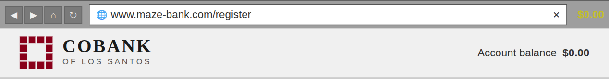

# COBANK 🏦

Cobank is a fictional online bank whose front end is built in React Native and whose back end is built in Spring Boot (Java) and COBOL. 

# Project's Goal

The goal of the project is to have a user-friendly interface while benefiting from the security and functionality provided by a Spring Boot and COBOL back-end.

I use Spring Boot as an API to manage requests, and the business logic is entirely handled by COBOL.

The UI is inspired by the “Maze Bank” featured in GTA V.

# Installation 

**Backend**
1. `git clone git@github.com:raph-bl/Cobank.git`
2. `cd backend && docker compose up --build`
3. Once built you can start the back-end with `mvn spring-boot:run`

**Frontend**
1. `cd frontend`
2. `npm i`
3. `npm run start`

You can then access to the project on `http://localhost:3000/`
